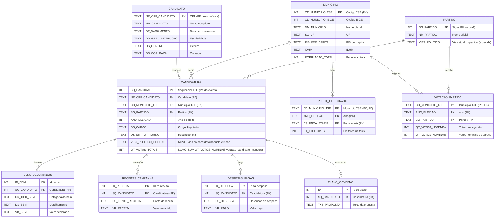
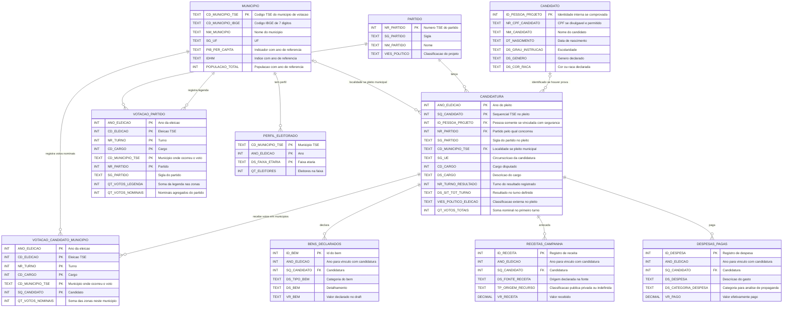

[[EDR - Projeto da disciplina]]
  
# ER — Modelo Joao Carlos v2 (derivado)

 Derivado de [[Tabelas - Joao Carlos]] (mantidas as colunas/tipos originais do draft).

  ## O que mudou em relação ao original

- **`CANDIDATURA` ganha `VIES_POLITICO_ELEICAO` (TEXT):** viés político do candidato **naquela eleição** (snapshot temporal — o candidato pode trocar de partido entre pleitos, por isso fica no evento `CANDIDATURA`, não no `CANDIDATO` pessoa-física).

- **`CANDIDATURA` ganha `QT_VOTOS_TOTAIS` (INT):** total de votos do candidato na eleição, extraído dos **dados originais do TSE de votação por candidato por município/zona** (`votacao_candidato_munzona_<ANO>_<UF>.csv`, soma de `QT_VOTOS_NOMINAIS` por `SQ_CANDIDATO` + `ANO_ELEICAO`). Ver dicionário abaixo. Nenhuma tabela nova foi criada para isso.
 

## Dicionário dos campos novos (origem TSE)

  

| Campo (`CANDIDATURA`) | Tipo | Origem no dado original do TSE | Regra |

| :--- | :--- | :--- | :--- |

| **VIES_POLITICO_ELEICAO** | Texto | Classificação do projeto aplicada ao partido/coligação do candidato **naquela eleição** (cf. `PARTIDO.VIES_POLITICO`) | Snapshot temporal: gravar o viés vigente no pleito, pois o candidato pode mudar de partido entre eleições |

| **QT_VOTOS_TOTAIS** | Numérico | Dados originais do TSE de **votação por candidato por município/zona** (`votacao_candidato_munzona_<ANO>_<UF>.csv`, portal `dadosabertos.tse.jus.br`), campo `QT_VOTOS_NOMINAIS` | `SUM(QT_VOTOS_NOMINAIS)` agrupado por `SQ_CANDIDATO` + `ANO_ELEICAO` (+ `CD_ELEICAO`/`NR_TURNO` quando houver 2º turno). Não usar `VOTACAO_PARTIDO` como fonte (aquele é por partido, não por candidato) |

  

## Como agrupar por município (não por partido)

  

1. **Agregue zona → município:** `SUM(QT_VOTOS_NOMINAIS)` por `ANO_ELEICAO` + `CD_ELEICAO` + `NR_TURNO` + `CD_MUNICIPIO` + `CD_CARGO` + `SQ_CANDIDATO`, no arquivo `votacao_candidato_munzona_<ANO>_<UF>.csv` (portal `dadosabertos.tse.jus.br`, anos `2018`, `2020`, `2022`, `2024`; Latin-1, `;`, campos entre aspas). Zona sozinha não vale — uma zona cobre vários municípios e vice-versa. Esse passo gera exatamente o `QT_VOTOS_TOTAIS` da candidatura.

2. **Atribua o viés a cada linha de candidato:** o próprio arquivo de votação já traz `NR_PARTIDO` — junte com a tabela de viés por `NR_PARTIDO` + `ANO_ELEICAO` (viés é snapshot por eleição; use `CONSULTA_COLIGACAO`/`DS_COMPOSICAO_COLIGACAO` se quiser refinar por coligação/federação). Opcional: junte com `CONSULTA_CAND` por `ANO_ELEICAO` + `CD_ELEICAO` + `SQ_CANDIDATO` para filtrar `NM_TIPO_DESTINACAO_VOTOS = 'Válido'` e descartar indeferidos. Legenda (`QT_VOTOS_LEGENDA`, de `votacao_partido_munzona_<ANO>_<UF>.csv`) soma-se à parte — nunca somar os nominais dos dois arquivos.

3. **Some por viés dentro do município** e calcule o share sobre votos válidos (nominais + legenda; denominadores em `detalhe_votacao_munzona_<ANO>_<UF>.csv`: `QT_APTOS`, `QT_COMPARECIMENTO`, brancos/nulos). Duas leituras complementares para a linha do tempo:

- share por viés (`% Esquerda` … `% Direita` por município × eleição);

- índice contínuo: `Σ(share_viés × peso)`, com pesos tipo `Esquerda=-2` … `Direita=+2` — um número por município por eleição, ótimo para gráfico temporal e correlação com PIB/IDHM.

  

### Pegadinhas que quebram a análise (todas verificadas)

  

- **Nunca agregue sem `NR_TURNO`.** Para série temporal comparável, use o **1º turno**: o 2º só existe em alguns municípios e com só 2 opções.

- **Não misture cargos.** 2018/2022 são eleições gerais (presidente, governador, deputados), 2020/2024 são municipais (prefeito, vereador). Uma timeline única "2018→2024" mistura universos diferentes — duas séries, ou fixar o cargo executivo (`PRESIDENTE` × `PREFEITO`) e rotular a quebra no gráfico.

- **`CD_MUNICIPIO` (TSE) ≠ `CD_MUNICIPIO_IBGE`.** São códigos diferentes; precisa de tabela de correspondência (a doc técnica do TSE cita o código IBGE como `cdmi`). Sem isso, o join com `DIM_MUNICIPIO`/IBGE falha silenciosamente.

- **Voto em trânsito e `SG_UE` especial (`BR`/`VT`/`ZZ`):** decida excluir ou isolar antes de agregar, senão inflam o município de votação.

- **`SQ_CANDIDATO` vale só no pleito** — o join votação↔candidatura seguro é `ANO_ELEICAO` + `CD_ELEICAO` + `SQ_CANDIDATO`.

  

Em resumo: votação-candidato → soma por zona → rotula viés via partido-eleição → share/índice por município × ano, com denominadores do detalhe e filtro de 1º turno + cargo fixo.

  

  

## Proposta alternativa: voto por candidato e município

**Hipótese de modelagem, não substitui o mermaid acima.** Preserva os campos e entidades do desenho do Joao Carlos e acrescenta a votação nominal por candidato e município. `VOTACAO_PARTIDO` conserva votos nominais e de legenda; os nominais já estão contados na votação por candidato e não devem ser somados duas vezes. A única entidade retirada é `PLANO_GOVERNO`, pois a análise de propostas saiu do escopo. Não se cria tabela de viés do município nem de comparecimento (este último é um possível complemento da dashboard).

  

  

### Dicionário e origem dos campos da proposta

  

| Entidade/campos | Origem e significado | Grão ou regra de uso |

| :--- | :--- | :--- |

| `MUNICIPIO.CD_MUNICIPIO_TSE`, `CD_MUNICIPIO_IBGE` | Código eleitoral da localidade em que o voto foi depositado e código IBGE de sete dígitos, ligados pela [correspondência oficial TSE–IBGE](https://dadosabertos.tse.jus.br/dataset/codigos-oficiais-de-uf-e-municipios-segundo-o-tse-e-o-ibge). | Chave territorial da votação **não** é necessariamente `CANDIDATURA.SG_UE`: em eleições gerais a circunscrição da candidatura pode ser a UF ou o país. Não juntar por nome de município. |

| `MUNICIPIO.NM_MUNICIPIO`, `SG_UF`, `PIB_PER_CAPITA`, `IDHM`, `POPULACAO_TOTAL` | Campos do rascunho original preservados. Os três indicadores dependem das fontes IBGE/Atlas, não da votação TSE. | Não presumir que valores na entidade municipal valem para todos os anos: guardar o ano de referência na extração/consulta (IDHM municipal do Atlas: 1991, 2000 ou 2010). |

| `CANDIDATO.ID_PESSOA_PROJETO`, `NR_CPF_CANDIDATO`, `NM_CANDIDATO`, `DT_NASCIMENTO`, `DS_GRAU_INSTRUCAO`, `DS_GENERO`, `DS_COR_RACA` | Os seis campos pessoais do primeiro mermaid foram preservados. `ID_PESSOA_PROJETO` é identificador **interno proposto**, não dado oficial. | O CPF foi mantido como campo **opcional**, não como chave: pode estar oculto por LGPD. Só relacionar pleitos à mesma pessoa quando houver evidência confiável; `SQ_CANDIDATO` não serve como identidade permanente. |

| `PARTIDO.NR_PARTIDO`, `SG_PARTIDO`, `NM_PARTIDO`, `VIES_POLITICO` | Número usado para junção com TSE, sigla/nome do rascunho e sua classificação política externa. | `SG_PARTIDO` não é chave nesta proposta. Para viés histórico, classificar por **partido + eleição** ou usar `CANDIDATURA.VIES_POLITICO_ELEICAO`; nunca aplicar o viés atual retroativamente. |

| `CANDIDATURA.ANO_ELEICAO`, `SQ_CANDIDATO`, `ID_PESSOA_PROJETO`, `NR_PARTIDO`, `SG_PARTIDO`, `CD_MUNICIPIO_TSE`, `SG_UE`, `CD_CARGO`, `DS_CARGO`, `NR_TURNO_RESULTADO`, `DS_SIT_TOT_TURNO` | Conserva os campos do draft e os complementa para distinguir circunscrição, cargo e turno; `NR_TURNO_RESULTADO` é **proposto**, não nome confirmado no CSV. | `CD_MUNICIPIO_TSE` só aponta município quando a candidatura tem circunscrição municipal; para eleições gerais pode ficar vazio e `SG_UE` aponta a circunscrição (UF/BR). O município **onde houve voto** está em `VOTACAO_CANDIDATO_MUNICIPIO`. |

| `CANDIDATURA.VIES_POLITICO_ELEICAO` | Classificação **externa ao TSE**, associada à candidatura no pleito. | Fonte, regra e ano de validade da classificação devem ser registrados; coligação/federação exige regra própria se sua interpretação for diferente da do partido. |

| `CANDIDATURA.QT_VOTOS_TOTAIS` | Soma de `VOTACAO_CANDIDATO_MUNICIPIO.QT_VOTOS_NOMINAIS` sobre **todos os municípios** da circunscrição; campo resumido, não substitui a tabela municipal. | Por convenção desta proposta, **1º turno**, mesmo `CD_CARGO` da candidatura. Se precisar comparar custos no 2º turno, calcular outro total a partir da tabela municipal, sem sobrescrever este campo. Não somar o total à tabela detalhada. |

| `VOTACAO_CANDIDATO_MUNICIPIO.QT_VOTOS_NOMINAIS` | [Votação nominal por município e zona](https://dadosabertos.tse.jus.br/dataset/resultados-2024): somar `QT_VOTOS_NOMINAIS` das zonas por ano + eleição + turno + cargo + município TSE + `SQ_CANDIDATO`. | **Uma linha por candidato no município, eleição, turno e cargo**; município não é o partido do candidato. Conferir destinação dos votos ao determinar o universo de votos válidos. |

| `VOTACAO_PARTIDO.SG_PARTIDO`, `QT_VOTOS_LEGENDA`, `QT_VOTOS_NOMINAIS` | [Votação em partido por município e zona](https://dadosabertos.tse.jus.br/dataset/resultados-2024): somar por ano + eleição + turno + cargo + município TSE + partido. Os dois tipos de voto do draft são preservados. | `QT_VOTOS_NOMINAIS` aqui **repete a agregação** dos votos nominais da tabela por candidato; serve para conferência ou consulta partidária, nunca somar os dois arquivos na mesma medida. Cargos sem legenda não recebem votos fictícios. |

| `BENS_DECLARADOS.ID_BEM`, `SQ_CANDIDATO`, `DS_TIPO_BEM`, `DS_BEM`, `VR_BEM` | Campos do primeiro mermaid preservados; ano incluído para não vincular bens de outra eleição. | Relacionar à mesma candidatura/pleito; `VR_BEM` permanece `TEXT` como no draft, não deve ser tratado como número sem conversão explícita. |

| `PERFIL_ELEITORADO.CD_MUNICIPIO_TSE`, `ANO_ELEICAO`, `DS_FAIXA_ETARIA`, `QT_ELEITORES` | Campos do primeiro mermaid preservados: perfil de eleitores por faixa etária do município. | `QT_ELEITORES` é tamanho da faixa no cadastro, **não** votos ou comparecimento dessa faixa. |

| `RECEITAS_CAMPANHA.ID_RECEITA`, `DS_FONTE_RECEITA`, `VR_RECEITA`, `TP_ORIGEM_RECURSO` | Receitas da [prestação de contas de candidatos](https://dadosabertos.tse.jus.br/dataset/prestacao-de-contas-eleitorais-2024); `ID_RECEITA` é identificador interno desta proposta e `TP_ORIGEM_RECURSO` é **classificação do projeto** (`PUBLICO`, `PRIVADO`, `INDEFINIDO`) aplicada à origem declarada, não colunas presumidas do CSV. | Agregar por candidatura e classe para a questão 15. Receita **não** é despesa; conferir transferências e categorias de cada ano antes de classificar como recurso público/privado. |

| `DESPESAS_PAGAS.ID_DESPESA`, `DS_DESPESA`, `VR_PAGO`, `DS_CATEGORIA_DESPESA` | Despesas da mesma prestação de contas; `ID_DESPESA` é identificador interno e `DS_CATEGORIA_DESPESA` é classificação analítica para a questão 17 (propaganda), não colunas presumidas do CSV. | `VR_PAGO` deve ter tipo monetário, não `TEXT` como no draft. Nuvem de palavras baseada na descrição/categoria das despesas, **não** em propostas de governo. |

  

### Perguntas respondidas sem guardar métricas redundantes

  

- **Questão 1 — custo por voto:** `SUM(VR_PAGO)` da candidatura na campanha dividido por `QT_VOTOS_TOTAIS` convencionado no **1º turno** (denominador maior que zero). A despesa da campanha não está necessariamente separada por turno nem por município: esta razão é uma métrica comparativa, não um gasto exclusivo do 1º turno ou um custo municipal por voto.

- **Questão 1 — custo por cadeira:** deixar explícita a definição: (a) gastos dos eleitos / número de cadeiras conquistadas pelos eleitos, ou (b) gastos de **todos** os concorrentes do grupo / cadeiras conquistadas pelo grupo. Requer resultado eleitoral e mesmo pleito/cargo; se não houver cadeira conquistada, a razão é indefinida. Não é o preço causal de uma cadeira.

- **Questões 2 e 15:** comparar gasto ou origem **das receitas** de candidaturas com a proporção eleita, no mesmo cargo e eleição; não atribuir automaticamente uma despesa específica a uma receita pública/privada.

- **Questões 7 e 13–14:** votos de legenda saem de `VOTACAO_PARTIDO`; para o viés municipal somar votos nominais de **todos os candidatos** classificados em cada viés e, quando aplicáveis, votos de legenda classificados pela mesma fonte externa por `NR_PARTIDO` + `ANO_ELEICAO`. `share_viés = votos_válidos_do_viés / votos_válidos_do_município` no mesmo turno/cargo; comparar preferencialmente o 1º turno. Isso é **consulta**, não entidade `VIES_MUNICIPIO`.

- **Questões 3, 4, 6 e 10:** indicadores IBGE/Atlas e perfil eleitoral mantêm seu próprio **ano de referência**; comparecimento/abstenção é opcional na dashboard. Perfil da população jovem não prova como cada faixa etária votou. Cruzar dados territoriais somente via código IBGE correspondente.

- **Questão 18:** sem uma identificação pessoal comprovada entre pleitos, mostrar **trajetórias de candidaturas** por eleição, não afirmar que o mesmo indivíduo sobreviveu politicamente.

  

Antes de implementar uma carga, conferir o `leia-me.pdf` e os cabeçalhos de **cada ano** das fontes do TSE; o esquema acima é uma proposta conceitual e `ID_PESSOA_PROJETO`, `NR_TURNO_RESULTADO`, `TP_ORIGEM_RECURSO` e `DS_CATEGORIA_DESPESA` são campos projetados, não dados oficiais.

```mermaid

erDiagram

%% Variante da proposta anterior com comparecimento municipal.

%% Comparecimento: eleitorado por eleicao, turno e municipio; nao por cargo ou partido.

MUNICIPIO {

TEXT CD_MUNICIPIO_TSE PK "Codigo TSE do municipio de votacao"

TEXT CD_MUNICIPIO_IBGE "Codigo IBGE de 7 digitos"

TEXT NM_MUNICIPIO "Nome do municipio"

TEXT SG_UF "UF"

TEXT PIB_PER_CAPITA "Indicador com ano de referencia"

TEXT IDHM "Indice com ano de referencia"

INT POPULACAO_TOTAL "Populacao com ano de referencia"

}

  

CANDIDATO {

INT ID_PESSOA_PROJETO PK "Identidade interna se comprovada"

TEXT NR_CPF_CANDIDATO "CPF se divulgavel e permitido"

TEXT NM_CANDIDATO "Nome do candidato"

TEXT DT_NASCIMENTO "Data de nascimento"

TEXT DS_GRAU_INSTRUCAO "Escolaridade"

TEXT DS_GENERO "Genero declarado"

TEXT DS_COR_RACA "Cor ou raca declarada"

}

  

PARTIDO {

INT NR_PARTIDO PK "Numero TSE do partido"

TEXT SG_PARTIDO "Sigla"

TEXT NM_PARTIDO "Nome"

TEXT VIES_POLITICO "Classificacao do projeto"

}

  

CANDIDATURA {

INT ANO_ELEICAO PK "Ano do pleito"

INT SQ_CANDIDATO PK "Sequencial TSE no pleito"

INT ID_PESSOA_PROJETO FK "Pessoa somente se vinculada com seguranca"

INT NR_PARTIDO FK "Partido pelo qual concorreu"

TEXT SG_PARTIDO "Sigla do partido no pleito"

TEXT CD_MUNICIPIO_TSE FK "Localidade se pleito municipal"

TEXT SG_UE "Circunscricao da candidatura"

INT CD_CARGO "Cargo disputado"

TEXT DS_CARGO "Descricao do cargo"

INT NR_TURNO_RESULTADO "Turno do resultado registrado"

TEXT DS_SIT_TOT_TURNO "Resultado no turno definido"

TEXT VIES_POLITICO_ELEICAO "Classificacao externa no pleito"

INT QT_VOTOS_TOTAIS "Soma nominal no primeiro turno"

}

  

VOTACAO_CANDIDATO_MUNICIPIO {

INT ANO_ELEICAO PK "Ano da eleicao"

INT CD_ELEICAO PK "Eleicao TSE"

INT NR_TURNO PK "Turno"

INT CD_CARGO PK "Cargo"

TEXT CD_MUNICIPIO_TSE PK "Municipio onde ocorreu o voto"

INT SQ_CANDIDATO PK "Candidato"

INT QT_VOTOS_NOMINAIS "Soma das zonas neste municipio"

}

  

VOTACAO_PARTIDO {

INT ANO_ELEICAO PK "Ano da eleicao"

INT CD_ELEICAO PK "Eleicao TSE"

INT NR_TURNO PK "Turno"

INT CD_CARGO PK "Cargo"

TEXT CD_MUNICIPIO_TSE PK "Municipio onde ocorreu o voto"

INT NR_PARTIDO PK "Partido"

TEXT SG_PARTIDO "Sigla do partido"

INT QT_VOTOS_LEGENDA "Soma da legenda nas zonas"

INT QT_VOTOS_NOMINAIS "Nominais agregados do partido"

}

  

COMPARECIMENTO_MUNICIPIO {

INT ANO_ELEICAO PK "Ano do pleito"

INT CD_ELEICAO PK "Identificador logico do pleito"

INT NR_TURNO PK "Turno"

TEXT CD_MUNICIPIO_TSE PK "Municipio TSE"

INT QT_APTOS "Eleitores aptos"

INT QT_COMPARECIMENTO "Eleitores que compareceram"

INT QT_ABSTENCAO "Eleitores que nao compareceram"

}

  

BENS_DECLARADOS {

INT ID_BEM PK "Id do bem"

INT ANO_ELEICAO "Ano para vinculo com candidatura"

INT SQ_CANDIDATO FK "Candidatura"

TEXT DS_TIPO_BEM "Categoria do bem"

TEXT DS_BEM "Detalhamento"

TEXT VR_BEM "Valor declarado no draft"

}

  

PERFIL_ELEITORADO {

TEXT CD_MUNICIPIO_TSE PK "Municipio TSE"

INT ANO_ELEICAO PK "Ano"

TEXT DS_FAIXA_ETARIA PK "Faixa etaria"

INT QT_ELEITORES "Eleitores na faixa"

}

  

RECEITAS_CAMPANHA {

INT ID_RECEITA PK "Registro de receita"

INT ANO_ELEICAO "Ano para vinculo com candidatura"

INT SQ_CANDIDATO FK "Candidatura"

TEXT DS_FONTE_RECEITA "Origem declarada na fonte"

TEXT TP_ORIGEM_RECURSO "Classificacao publica privada ou indefinida"

DECIMAL VR_RECEITA "Valor recebido"

}

  

DESPESAS_PAGAS {

INT ID_DESPESA PK "Registro de despesa"

INT ANO_ELEICAO "Ano para vinculo com candidatura"

INT SQ_CANDIDATO FK "Candidatura"

TEXT DS_DESPESA "Descricao do gasto"

TEXT DS_CATEGORIA_DESPESA "Categoria para analise de propaganda"

DECIMAL VR_PAGO "Valor efetivamente pago"

}

  

CANDIDATO o|--o{ CANDIDATURA : "identificado se houver prova"

PARTIDO ||--o{ CANDIDATURA : "lança"

MUNICIPIO o|--o{ CANDIDATURA : "localidade se pleito municipal"

CANDIDATURA ||--o{ VOTACAO_CANDIDATO_MUNICIPIO : "recebe votos em municipios"

MUNICIPIO ||--o{ VOTACAO_CANDIDATO_MUNICIPIO : "registra votos nominais"

MUNICIPIO ||--o{ VOTACAO_PARTIDO : "registra legenda"

PARTIDO ||--o{ VOTACAO_PARTIDO : "recebe legenda"

MUNICIPIO ||--o{ COMPARECIMENTO_MUNICIPIO : "tem comparecimento por pleito"

MUNICIPIO ||--o{ PERFIL_ELEITORADO : "tem perfil"

CANDIDATURA ||--o{ BENS_DECLARADOS : "declara"

CANDIDATURA ||--o{ RECEITAS_CAMPANHA : "arrecada"

CANDIDATURA ||--o{ DESPESAS_PAGAS : "paga"

```

  

